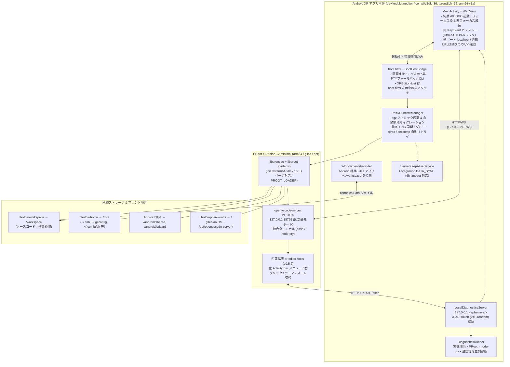

# XR-Editor

> **Android XR（XREAL AURA 等）の空間デスクトップ向けに、物理キーボード＋マウス／トラックパッドで使えるコードエディタと Debian POSIX 環境を APK 1 本に完全内蔵した開発者向けエディタ。**

外部サーバーの構築・起動や Termux の別途導入は不要です。APK をインストールして起動するだけで、内蔵の **`openvscode-server` + Debian 12 minimal (`arm64`)** がローカルで自動起動します。

---

## 目次

- [コンセプト & 設計思想](#コンセプト--設計思想)
- [システムアーキテクチャ](#システムアーキテクチャ)
- [技術選定と工夫（なぜこの構成か）](#技術選定と工夫なぜこの構成か)
- [現時点の実装機能（v0.5.0）](#現時点の実装機能v050)
- [ディレクトリ構成 & モジュール一覧](#ディレクトリ構成--モジュール一覧)
- [インストール & 使い方](#インストール--使い方)
- [ローカルビルド & CI/CD](#ローカルビルド--cicd)
- [現在のステータス & ロードマップ](#現在のステータス--ロードマップ)

---

## コンセプト & 設計思想

Android XR グラス（XREAL AURA のような光学シースルー型：OST、またはパススルー型：VST）に **物理キーボードとマウス／トラックパッド** を接続し、空間上に複数のウィンドウを並べて開発するワークフローを想定しています。

1. **単体完結 APK（Zero External Setup）**
   - 従来の「Termux を入れて PRoot を設定し、別アプリからブラウザ接続する」手間を排除。
   - `PRoot`・`Debian 12 (bookworm-slim, arm64)`・`openvscode-server (linux-arm64)` を約 107 MB の APK 1 本に同梱し、初回起動時に自動展開・自動起動します。
2. **スマホ UI を捨て、空間デスクトップに絞る**
   - ソフトウェアキーボード補助ボタンやタッチ操作前提のカスタム UI は持たせず、デスクトップ版と同じ VS Code Web UI（Monaco Editor + xterm.js）に物理キーボードの実 `KeyEvent` をそのまま通します。
   - 光学シースルー（OST）での視認性を最優先し、純黒 `#000000` 背景・太めフォント・非フォーカス時の自動減光・別ポート開発サーバーの隣ウィンドウ起動など、XR マルチウィンドウ特有の体験を作り込んでいます。
3. **Android 標準仕様（`targetSdk = 35`）を崩さないクリーン実装**
   - Termux の `targetSdk = 28` ダウングレード手法や GPL-3.0 ソース流用を避け、`targetSdk = 35`（Android 15 W^X）のまま動作する `PROOT_LOADER` 方式と、Android 標準 SDK によるゼロからの Kotlin 実装を採用しています。

---

## システムアーキテクチャ

### 全体構成図



### ストレージ・マウント設計（アプリ更新でもユーザーデータを失わない分離構造）

| ホスト側パス（Android） | ゲスト側パス（Debian） | 役割・アップデート耐性 |
| --- | --- | --- |
| `filesDir/workspace` | `/workspace` | 作業用ワークスペース。`rootfs/` 外に分離されており、ランタイム更新時も保持。`XrDocumentsProvider` 経由で Android 標準「Files」アプリからも直接読み書き可能。 |
| `filesDir/home` | `/root` | 永続ホームディレクトリ。`~/.bashrc`・`~/.ssh`・`~/.gitconfig`・`~/.config/gh`・シェル履歴を保持（旧 `rootfs/` 内データがある場合は自動移行）。 |
| `filesDir/posix/vscode-data` | `/var/lib/xr-vscode` | `openvscode-server` のユーザー設定（`settings.json`）・拡張機能・状態保存領域。 |
| `filesDir/posix/rootfs` | `/` | Debian 12 minimal rootfs と `/opt/openvscode-server`（更新時は staging で展開後にアトミック差し替え）。 |
| `getExternalFilesDir("shared")` | `/android/shared` | 権限不要で使える Android 共有領域（`/workspace/android/shared` からシンボリックリンク参照）。 |
| `/storage/emulated/0` | `/android/sdcard` | 全ファイルアクセス許可（`MANAGE_EXTERNAL_STORAGE`）時のみマウント（`/workspace/android/sdcard` から参照）。 |
| `filesDir/posix/sysdata/*` | `/proc/{stat,loadavg,uptime,version,vmstat}` | Android の SELinux 制限で読めない `/proc` ファイルを補完し、`node` / `openvscode-server` のシステム情報参照エラーを回避。 |

### セキュリティ & プロセス分離の設計

- **JS ブリッジの厳格な隔離**：`XREditorHost`（`BootHostBridge`）と `allowFileAccess` は `file:///android_asset/boot.html` 表示中のみ有効化し、`openvscode-server` へ遷移する直前に `removeJavascriptInterface` で完全デタッチします。
- **トークン認証ループバック管理 API**：内蔵 VS Code 拡張 `xr-editor-tools` から Android 側機能（実機診断・クリップボードコピー・ログ閲覧・ストレージ権限設定・管理画面切替）を呼ぶ際は、起動ごとに生成する 24 バイトランダムトークン（`XR_ADMIN_TOKEN` / `X-XR-Token`）で `127.0.0.1` のみにバインドした `LocalDiagnosticsServer` へ通信します。
- **WebView ルーティング分離**：`file://` とエディタ自身のポート（`127.0.0.1:18765`）のみを WebView 内に留め、開発中の別ポート（例：`http://127.0.0.1:3000`）や OAuth 認証ページ等の外部 URL は `ACTION_VIEW` で Android XR 上の別ブラウザウィンドウに開きます。

---

## 技術選定と工夫（なぜこの構成か）

| 技術要素 | 採用内容 | 採用理由・解決した課題 |
| --- | --- | --- |
| **Android 15 W^X 対応** | `jniLibs/arm64-v8a/libproot.so` + `libproot-loader.so`（`useLegacyPackaging = true`、16KB ページアライメント、`PROOT_LOADER` 指定） | Android 10+ / `targetSdk = 35` ではアプリデータ領域からの直接 `execve()` が禁止される。PRoot 本体とローダーを `nativeLibraryDir` に配置し `PROOT_LOADER` で指定することで、`targetSdk` を下げずにゲスト ELF を実行可能。 |
| **ゲスト Linux** | `Debian 12 bookworm-slim`（`arm64` / `glibc` / `apt`、約 28.3 MB） | 公式 `openvscode-server` の `linux-arm64` バイナリは `glibc` 依存。Debian minimal を使うことで、バイナリの再ビルドや独自移植なしに `openvscode-server` と `apt install git gh curl` がそのまま動作。 |
| **エディタエンジン** | Gitpod `openvscode-server-v1.109.5`（`linux-arm64`、約 74.5 MB） | `code-server`（約 266 MB）と比べて約 1/3.5 のサイズ。APK 全体でも **約 106.6 MB** に収まる。 |
| **アセット圧縮形式** | `.tgz` + `androidResources.noCompress += listOf("tgz", "tar", "xz")` | Android Gradle Plugin (AGP) は `assets/` 内の `.tar.gz` を勝手に gunzip して拡張子を削る挙動があり、APK 肥大化（334 MB）と `FileNotFoundException` を引き起こす。`.tgz` + `noCompress` で確実に防止。 |
| **ポート固定化** | 優先固定ポート `18765`（使用中のみ空きポートへフォールバック） | ランダムポートだと毎回オリジンが変わり、VS Code Web の IndexedDB（開いていたタブ・レイアウト状態）が初期化されてしまう問題を解消。 |
| **内蔵拡張の配置** | `/opt/openvscode-server/extensions/xr-editor-tools/` へ起動ごとに自動同期 | システム拡張ディレクトリに配置することで `extensions.json` キャッシュによるスキップを防ぎ、rootfs を再展開せずに APK 上書き更新だけで拡張機能を最新化。 |
| **DNS & Seccomp 耐性** | Android `ConnectivityManager` から動的 DNS 取得＋起動失敗時 `PROOT_NO_SECCOMP=1` 自動リトライ | 企業 Wi-Fi や VPN 環境での固定 DNS ブロック回避と、端末カーネルによる seccomp 干渉への自動フォールバックを両立。 |

---

## 現時点の実装機能（v0.5.0）

### 1. ランタイム自動起動 & 永続化
- 初回起動時に `assets/runtime/*.tgz` を `staging/` へ展開し、完了後にアトミックに `rootfs/` へ切り替え（途中中断で壊れない設計）。
- `TarGzExtractor`（Apache Commons Compress + `java.nio.file.Files`）により POSIX シンボリックリンク・ハードリンク・実行権限ビットを保持しつつパストラバーサルを防御。
- Android 15 の `FOREGROUND_SERVICE_TYPE_DATA_SYNC` 6 時間上限クラッシュ対策として `Service.onTimeout()` を実装し、フォアグラウンド復帰時に自動再登録。

### 2. Android XR 空間デスクトップ向け UX
- **OST / VST 最適化プリセット**：初期状態で純黒 OST テーマ（`#000000` 背景、`fontSize: 16`、`lineHeight: 26`、`fontWeight: "500"`、`window.zoomLevel: 0.5`、太さ `3px` のシアンカーソル、明るめコメント色 `#8da2be`、ミニマップ・Welcome・パンくず・テレメトリ無効化）を非破壊マージ適用。
- **統合ターミナルの WebView 安定化**：`terminal.integrated.gpuAcceleration: "off"` を初期設定し、Android WebView での WebGL 黒画面・文字化けを防止。
- **空間マルチウィンドウ視認性**：ウィンドウ外周に `1.5dp` のフォーカス枠（アクティブ時 `#38BDF8` / 非アクティブ時 `#18181B`）を描画し、`onWindowFocusChanged` で非フォーカス時に `alpha = 0.55f` へ自動減光。
- **物理キーボード & トラックパッド配慮**：
  - WebView のピンチズームを無効化し、トラックパッド誤操作によるレイアウト崩れを防止（倍率調整は VS Code の `window.zoomLevel` で統一）。
  - 通常のキーボードショートカットはネイティブ `KeyEvent` のまま Monaco / xterm.js へ直送し、`Ctrl+Alt+D` のみホスト側でフックして管理・診断画面を切り替え。
  - `OnBackPressedCallback` により誤操作の Back でエディタが即終了しないようガード。

### 3. VS Code 内蔵メニュー（`xr-editor-tools` v0.5.2）
XR 空間で押しづらい右下ボタンを避け、**左端 Activity Bar の `XR-Editor` アイコン（バイザー型アイコン）**、**右クリックメニュー**、**エディタ右上ボタン**、**左下ステータスバー（`XRメニュー`）**、**コマンドパレット**から以下を実行できます：
- **実機チェックを実行**：診断を実行し、Markdown レポートを VS Code タブで開くと同時に Android クリップボードへ自動コピー
- **統合ターミナルを開閉**：JIS キーボードで押しにくい `Ctrl+\`` の代替としてワンクリック開閉
- **表示サイズを変更**：`標準 (0.5 / 16px)` / `大 (1.0 / 17px)` / `特大 (1.5 / 19px)`
- **光学テーマを切替**：`OST 純黒 (#000000)` / `VST 暗灰 (#12141a)`
- **起動・エラーログを開く**：最新ログをタブ表示＆クリップボードコピー
- **管理画面を開く**：`boot.html`（非 PTY フォールバック CLI・ストレージ許可・サーバー再起動）へ遷移
- **Android ストレージアクセスを許可**：システムの全ファイルアクセス設定画面を開く

### 4. Android XR ↔ POSIX 双方向ファイル共有
- **Android → POSIX（`XrDocumentsProvider`）**：Android 標準「Files」アプリから本アプリの `/workspace` を通常フォルダとして一覧・作成・編集・リネーム・削除・検索可能。`canonicalPath` 検証により、シンボリックリンク経由で `/android` や `/` へ脱出するアクセスをブロック。
- **POSIX → Android**：`/workspace/android/shared`（常時利用可）および `/workspace/android/sdcard`（権限許可時）から Android 側ファイルへ直接アクセス可能。

### 5. 実機診断チェッカー & 非 PTY フォールバック CLI
- `DiagnosticsRunner` が端末情報（ABI・4KB/16KB ページサイズ・SELinux・WebView・ディスプレイ・接続中 KB/Mouse・DNS・バッテリー最適化等）に加え、PRoot Gate 1 確認後に **5 系統のプローブを並列実行**：
  1. Node.js & `openvscode-server` バージョン確認
  2. `node-pty.spawn` 実起動テスト（統合ターミナル PTY 動作検証）
  3. `@parcel/watcher` & `inotify` 上限確認
  4. `/workspace` 読み書き & `/android/{shared,sdcard}` マウント確認
  5. DNS 解決・Debian apt HTTP・GitHub HTTPS・`dpkg`/`apt`/`git`/`gh`/`curl` 確認
- 万一 `node-pty` が動かない端末でも、`boot.html` のミニ CLI コンソールから PRoot 経由の非 PTY `bash -lc` を実行可能。

---

## ディレクトリ構成 & モジュール一覧

```text
.
├── README.md
├── spec.md                                 # v0.5.0 仕様書
├── THIRD_PARTY_NOTICES.md                  # 同梱 OSS ライセンス一覧
├── .github/workflows/ci.yml                # NDK PRoot + Debian + OpenVSCode 同梱 APK CI/CD
├── scripts/
│   ├── build-proot-android.sh              # Android NDK で PRoot + talloc (static) をクロスコンパイル
│   └── fetch-runtime-assets.sh             # Debian bookworm-slim rootfs & openvscode-server を取得
└── android/
    ├── settings.gradle.kts
    ├── build.gradle.kts
    ├── gradle.properties
    └── app/
        ├── build.gradle.kts                # compileSdk=36, targetSdk=35, minSdk=34, arm64-v8a
        └── src/
            ├── main/
            │   ├── AndroidManifest.xml
            │   ├── assets/
            │   │   ├── boot.html           # 起動進捗・ログ・実機診断・非PTY CLI 画面
            │   │   └── runtime/            # CI/スクリプトで .tgz を配置
            │   ├── jniLibs/arm64-v8a/      # CI/スクリプトで libproot.so / libproot-loader.so を配置
            │   └── java/dev/koduki/xreditor/
            │       ├── MainActivity.kt             # WebView ホスト・URL ルーティング・フォーカス減光・ClipBoard
            │       ├── PosixRuntimeConfig.kt       # 純JVM 設定ビルダー（PRoot引数・環境変数・OST設定・DNS）
            │       ├── PosixRuntimeManager.kt      # アトミック展開・PRoot プロセス制御・自動復旧・拡張同期
            │       ├── TarGzExtractor.kt           # POSIX シンボリックリンク/権限保持 .tgz 展開器
            │       ├── XrDocumentsProvider.kt      # Android Files アプリ向け /workspace 公開プロバイダ
            │       ├── VsCodeExtensionAsset.kt     # 内蔵拡張 xr-editor-tools (v0.5.2) 生成・配置
            │       ├── LocalDiagnosticsServer.kt   # 127.0.0.1 トークン認証管理 HTTP サーバー
            │       ├── DiagnosticsRunner.kt        # 実機診断コレクタ & Markdown レポート生成
            │       ├── BootHostBridge.kt           # boot.html 専用非同期 JS ブリッジ
            │       ├── HardwareShortcutRouter.kt   # ホスト側キーボードショートカット判定 (Ctrl+Alt+D)
            │       └── ServerKeepAliveService.kt   # Foreground DATA_SYNC サービス (onTimeout 対応)
            └── test/java/dev/koduki/xreditor/
                ├── PosixRuntimeConfigTest.kt       # PRoot コマンド・ルーティング・DNS・設定マージテスト
                ├── TarGzExtractorTest.kt           # symlink/hardlink/chmod/パストラバーサル防御テスト
                ├── VsCodeExtensionAssetTest.kt     # 内蔵拡張マニフェスト・JS 構成テスト
                ├── DiagnosticsRunnerTest.kt        # 診断レポート Markdown フォーマットテスト
                └── HardwareShortcutRouterTest.kt   # Ctrl+Alt+D 判定・通常キー透過テスト
```

---

## インストール & 使い方

### 1. APK の取得とインストール

GitHub Actions の最新ビルド Artifacts（`xr-editor-debug-apk` 内の `xr-editor-debug.apk`）または [Releases](https://github.com/koduki/3d-editor/releases) から APK を取得します。

```bash
adb install -r xr-editor-debug.apk
```

### 2. 初回起動の流れ

1. アプリを起動すると純黒背景の起動画面（`boot.html`）が表示され、内蔵の Debian rootfs と `openvscode-server` が自動展開されます（初回のみ数十秒）。
2. ローカルサーバー（`http://127.0.0.1:18765`）が応答可能になると、自動的に VS Code UI へ切り替わります。
3. 2 回目以降は展開済み環境を再利用するため高速に起動します。

### 3. 基本操作（物理キーボード & メニュー）

| 操作 | 方法 |
| --- | --- |
| ファイルを開く / クイックオープン | 左エクスプローラー、または `Ctrl+P` / `Ctrl+O` |
| 保存 / タブを閉じる | `Ctrl+S` / `Ctrl+W` |
| 統合ターミナルを開閉 | `Ctrl+J`、または左端 **XR-Editor** メニューの「統合ターミナルを開閉」 |
| 表示サイズ / OST・VST テーマ切替 | 左端 **XR-Editor** アイコン（サイドバーメニュー） |
| 実機診断レポートの取得・コピー | 左端 **XR-Editor** メニュー →「実機チェックを実行」（自動でタブ表示＆クリップボードコピー） |
| 管理画面（ログ・ミニ CLI・再起動） | `Ctrl+Alt+D`、または左端 **XR-Editor** メニュー →「管理画面を開く」 |

### 4. Debian 環境への CLI ツール導入例（統合ターミナル内）

```bash
apt update && apt install -y ca-certificates git gh curl openssh-client
gh --version
```

`~/.ssh`・`~/.gitconfig`・`~/.config/gh` は `/root`（`filesDir/home`）に永続化されるため、アプリをアップデートしても認証情報や設定が維持されます。

---

## ローカルビルド & CI/CD

### ローカルビルド手順

前提環境：JDK 17、Android SDK（API 36 + Build-Tools 35.0.0 + NDK r27+）、Docker（`linux/arm64` Debian イメージ書き出し用）、`curl`、`make`

```bash
# 1. Android arm64-v8a 向け PRoot + talloc (static) をクロスコンパイル
#    -> android/app/src/main/jniLibs/arm64-v8a/{libproot.so, libproot-loader.so}
./scripts/build-proot-android.sh

# 2. Debian 12 bookworm-slim (arm64) rootfs & openvscode-server v1.109.5 を取得
#    -> android/app/src/main/assets/runtime/{debian-arm64-rootfs.tgz, openvscode-server-linux-arm64.tgz}
./scripts/fetch-runtime-assets.sh

# 3. ユニットテスト実行 & Debug APK ビルド
cd android
gradle :app:testDebugUnitTest :app:assembleDebug
```

### CI/CD（[`.github/workflows/ci.yml`](.github/workflows/ci.yml)）

- `main` / `feat/**` への push、Pull Request、`v*` タグ push、`workflow_dispatch` で自動実行。
- ビルド済み PRoot バイナリとランタイム `.tgz` をキャッシュし、通常 **約 1 分半** でユニットテスト実行＋Debug APK（約 106.6 MB）をビルド。
- APK 内部に `libproot.so` / `libproot-loader.so` / 両 `.tgz` が正しく同梱されていることを `unzip -l` で自動検証したうえで Artifact（`xr-editor-debug-apk`）へアップロード。
- リポジトリ Secrets（`ANDROID_KEYSTORE_BASE64` 等）が設定されている場合は署名済み Release APK / AAB も生成し、`v*` タグ時には GitHub Release を自動公開します。

---

## 現在のステータス & ロードマップ

### 到達状況（v0.5.0）
- **完了・実機確認済み**：単体完結 APK の自動ビルド、実機（Android XR）での `openvscode-server` 起動を確認済み。
- **v0.4.0 からの移行**：過去の XR-ACP Workbench 構成（外部 Node.js ブリッジ＋カスタム Web IDE）はタグ [`v0.4.0`](https://github.com/koduki/3d-editor/releases/tag/v0.4.0) としてアーカイブし、v0.5.0 で現行の最小単体完結アーキテクチャへ刷新しました。

### 今後の検討項目（実機診断レポートの結果を踏まえて優先順位付け）
- 統合ターミナル（`node-pty`）および `@parcel/watcher` の実機安定性検証・チューニング
- 物理キーボードの日本語 IME 変換挙動および JIS / US 配列ショートカットの微調整
- Android XR 空間マルチウィンドウでのリサイズ・フォーカス遷移・複数ウィンドウ開発ワークフローのさらなる改善
- 軽量な AI CLI（`gh copilot` / 各種エージェント CLI 等）を POSIX ターミナル上で快適に動かすための環境整備

---

## 関連ドキュメント & ライセンス

- 仕様書：[spec.md](spec.md)
- 同梱サードパーティ OSS ライセンス表記：[THIRD_PARTY_NOTICES.md](THIRD_PARTY_NOTICES.md)
