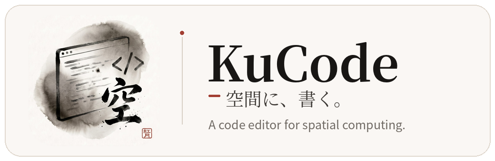
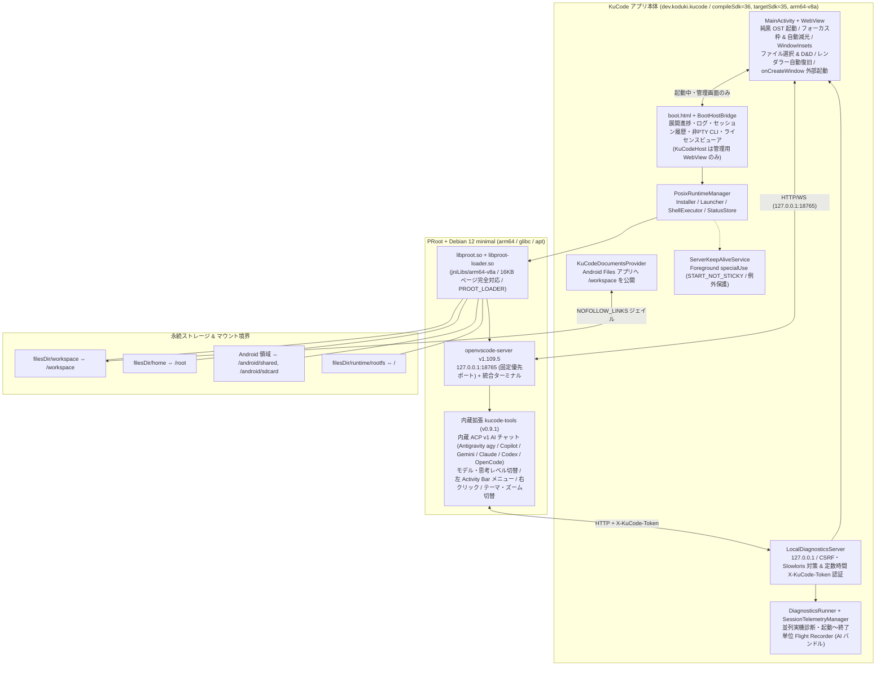

<p align="center">
  
</p>

# KuCode

*A code editor for spatial computing.*

XREAL AURAを想定したAndroid XR向けのVisual Studio Codeベースのエディタです。

AndroidXRで物理キーボードとマウスを想定して、`openvscode-server` の構築・起動や Termux などのターミナルを別途導入は不要で、単一の APK をインストールするだけで動作します。

内蔵の **`openvscode-server` + Debian 12 minimal (`arm64`)** がローカルで自動起動し、キーボード＋マウス／トラックパッドですぐにコードを書き始められます。

---

## 名前の由来

**KuCode**（読み：**くうこーど** / 英: *"koo-code"*）は、**空（くう）** に二つの意味を重ねています。

- **空間** — Android XR の空間コンピューティング環境に浮かび、目の前の空間でそのまま書けるエディタ。
- **空海** — 「弘法は筆を選ばず」でお馴染みの日本を代表する能筆家にして、スーパー僧侶。何処でも空海パワーで素敵な文章を！

当面はシンプルな2Dベースのエディタですが、将来的にはより空間コンピューティングに最適化したUXを目指します。

---

## コンセプト

1. **APK 1 本で完結**
   `PRoot`・`Debian 12 (bookworm-slim, arm64)`・`openvscode-server`・ライセンス一式を約 109 MiB の APK に同梱。初回起動時に自動展開・自動起動するため、`openvscode-server` の構築も Termux の別途導入も不要です。
2. **空間デスクトップ最適化**
   物理キーボード＋マウス／トラックパッド前提で設計し、スマホ向け仮想キーや過剰な独自 UI は持ちません。
3. **Android 標準準拠でクリーン**
   `targetSdk = 35` を維持し、分離ローダー型 PRoot（16KB ページ対応）と Android 標準 SDK によるクリーンな Kotlin 実装です。

## AURAセルフホスト（実装統合済み・実機受け入れ未完了）

汎用Linux IDEとして、永続Debian、独立管理するOpenVSCode、Android標準APIによるAPK配置・起動、同梱の独立Android拡張、Stable/Dev診断共有、固定ランタイム資産の取得を実装しています。AURA上でのARM64 SDK成立性とセルフホストE2Eは未検証です。詳細は [受け入れ手順](docs/aura-self-host-acceptance.md)、[spec.md 第5節](spec.md)、[ADR-0012](docs/adr/0012-aura-self-host-standard-linux.md)、[Epic #17](https://github.com/koduki/kucode/issues/17) を参照してください。

## 開発方針

- **AI エージェントに強く** — 内蔵 Debian POSIX 環境上で CLI 系 AI エージェントがそのまま動き、人と AI が同じ `/workspace` で協働して書く体験を目指します。
- **空間コンピューティング最適化をさらに** — マルチウィンドウ／空間配置、視線・ハンドトラッキングなど、XR ならではの操作体験へと発展させていきます。

---

## クイックスタート

### 1. インストール

日常利用（`~/.ssh` や `gh` 認証トークン等を保存する用途）では、[GitHub Releases](https://github.com/koduki/kucode/releases) から署名済みリリース版 **`kucode-release.apk`** を取得するか、下記のローカル手順で署名済みリリース APK をビルドしてインストールしてください。

```bash
adb install -r kucode-release.apk
```

> **セキュリティ上の注意**：`kucode-debug.apk`（`debuggable = true`）は開発・動作確認専用です。debug ビルドでは `adb shell run-as` を通じてアプリ専用領域の `~/.ssh` や `~/.config/gh` トークン等を読み取れるため、実際の秘密鍵や認証情報を保存する用途には使用しないでください。

初回起動時は `boot.html` で内蔵ランタイムを自動展開し、`http://127.0.0.1:18765` が応答可能になると起動ごとのトークンで自動接続してエディタ UI へ切り替わります（2 回目以降は展開済み環境を再利用）。

### 2. 基本操作（物理キーボード & 左メニュー）

| 操作 | 方法 |
| --- | --- |
| AI エージェント (ACP) チャットを開く | 左端 **KuCode** アイコン → **AI エージェント (ACP)**（既定: **Google Antigravity `agy acp`** / Copilot CLI / Gemini / Claude / Codex / OpenCode） |
| 選択範囲を AI (ACP) チャットへ送る | エディタで `Ctrl+Shift+I`、または右クリックメニュー |
| ファイルを開く / クイックオープン | 左エクスプローラー、または `Ctrl+P` / `Ctrl+O` |
| コピー / 切り取り / 貼り付け（エディタ） | `Ctrl+C` / `Ctrl+X` / `Ctrl+V`、右クリックメニュー、または左端 **KuCode** メニュー |
| コピー / 貼り付け（統合ターミナル） | 選択後に**右クリックで自動コピー**（または `Ctrl+Shift+C`）、貼り付けは `Ctrl+Shift+V` / `Ctrl+V`（`Shift+右クリック` でメニュー）、CLI では `kucode-copy` / `kucode-paste` |
| 保存 / タブを閉じる | `Ctrl+S` / `Ctrl+W` |
| 統合ターミナルを開閉 | `Ctrl+J`、または左端 **KuCode** アイコン →「ターミナル開閉」 |
| 表示サイズ / OST・VST テーマ切替 | 左端 **KuCode** アイコン（`標準 / 大 / 特大`、`OST 純黒 / VST 暗灰`） |
| 実機チェック（レポート表示＆自動コピー） | 左端 **KuCode** アイコン →「実機チェックを実行」 |
| セッション診断履歴 (Flight Recorder / AI 用) | 左端 **KuCode** アイコン →「セッション診断履歴 (AI用)」、または `kucode-logs` |
| 管理画面（ログ・ミニ CLI・ライセンス・再起動） | `Ctrl+Alt+D`、または左端 **KuCode** アイコン →「管理画面を開く」 |

### 3. AI エージェント (ACP) & CLI ツール導入例（統合ターミナル内）

```bash
# Google Antigravity CLI (既定 ACP エージェント) を導入してログイン（左 KuCode パネルからワンクリック実行も可能）
kucode-install-agy && agy acp --login

# GitHub Copilot CLI (ACP) を導入してログイン
kucode-install-copilot && copilot login

# 一般的な CLI ツール導入例
apt update && apt install -y ca-certificates git gh curl openssh-client
gh --version && node -v
```

`~/.local/bin`・`~/.gemini`・`~/.ssh`・`~/.gitconfig`・`~/.config/gh` は `rootfs/` 外の永続領域（`/root`）に保存されるため、アプリ更新後も引き継がれます。

---

## システムアーキテクチャ



### ストレージ・マウント構造

| ホスト側（Android） | ゲスト側（Debian） | 用途・永続性 |
| --- | --- | --- |
| `filesDir/workspace` | `/workspace` | 作業用コード領域。`rootfs/` 外に分離され更新時も保持。`KuCodeDocumentsProvider` 経由で Android 標準「Files」アプリから直接読み書き可能。 |
| `filesDir/home` | `/root` | 永続ホーム（`~/.bashrc`, `~/.profile`, `~/.local/bin`, `~/.gemini`, `~/.ssh`, `~/.gitconfig`, `~/.config/gh`, 履歴）。 |
| `filesDir/runtime/vscode-data` | `/var/lib/kucode-vscode` | `openvscode-server` の `user/Machine/settings.json`・拡張・状態領域（初期値は Machine 側のみにアトミック適用）。 |
| `filesDir/runtime/rootfs` | `/` | Debian 12 minimal + `/opt/openvscode-server` + `/usr/local/bin/node`（更新時は `staging/` 経由でアトミック入替、失敗時は自動ロールバック）。 |
| `getExternalFilesDir("shared")` | `/android/shared` | 権限不要の Android 共有領域（`/workspace/android/shared` から参照）。 |
| `/storage/emulated/0` | `/android/sdcard` | 全ファイルアクセス許可時のみマウント（`/workspace/android/sdcard` から参照）。 |
| `filesDir/runtime/sysdata/*` | `/proc/{stat,loadavg,uptime,version,vmstat}` | Android の SELinux 制限で読めない `/proc` の補完用ダミーファイル。 |

---

## 主な機能

- **内蔵 ACP v1 AI エージェントチャット（Google Antigravity 標準対応）**：OpenVSCode / Open VSX の制約に縛られず、`kucode-tools` 内蔵の OST 純黒チャットパネルから **Google Antigravity CLI（`agy acp`）** を既定エージェントとして、GitHub Copilot CLI（`copilot --acp --stdio`）・Gemini CLI・Claude Code・Codex CLI・OpenCode 等の ACP v1 エージェントをネイティブ接続（`configOptions` によるモデル・思考レベル切替、Diff 表示、`-32000` 認証誘導、`/workspace` 境界強制、権限承認 UI、選択範囲送信 `Ctrl+Shift+I`、`kucode-install-agy` / `kucode-install-copilot` 自動導入）。
- **ランタイム起動 & 耐障害性**：`.tgz` アトミック展開（symlink/hardlink/chmod 保持＆パストラバーサル防御）、rootfs 内バージョン管理と READY コミット／失敗時ロールバック、優先固定ポート `18765`＋孤児プロセス自動回収、Android システム DNS & 信頼済み CA 証明書（システム＋ユーザー CA）の自動同期、PRoot 向け `apt` 設定、起動失敗時 `PROOT_NO_SECCOMP=1` 自動リトライ、`libproot.so` / `libproot-loader.so` 双方の 16KB ページアライメント対応、`specialUse` FGS。
- **空間デスクトップ UX**：OST 純黒 `#000000` / VST 暗灰 `#12141a` 切替、表示サイズ 3 段階、フォーカス枠（`#38BDF8` / `#18181B`）＋非フォーカス自動減光（`alpha = 0.55f`）、Edge-to-Edge WindowInsets 対応、ファイル選択＆D&D、レンダラー自動復旧（エディタ＆管理画面）、ピンチズーム抑止、Back 誤終了ガード、`onCreateWindow` による隣ウィンドウ外部ブラウザ起動、統合ターミナル `gpuAcceleration: "off"`。
- **内蔵拡張 & 実機診断 / Flight Recorder**：左 Activity Bar の `KuCode` メニュー（`kucode-tools` を起動時自動同期）、Android `ClipboardManager` 連携によるエディタ／統合ターミナルのコピー＆貼り付け（`POST /copy`・`GET /clipboard`・`kucode-copy` / `kucode-paste`）、並列実機診断レポート、起動〜終了単位 Flight Recorder（異常終了照合・OpenVSCode サブログ回収・機密リダクション・AI 診断バンドル自動出力）、非 PTY フォールバック CLI コンソール（`boot.html`）。
- **双方向ファイル共有 & コンプライアンス**：`KuCodeDocumentsProvider`（`NOFOLLOW_LINKS` 境界制御・`notifyChange` 付き）、APK 内 `assets/licenses/` へのライセンス全文＋Debian パッケージマニフェスト自動同梱とアプリ内ライセンスビューア。

---

## 設計判断（Architecture Decision Records）

主要な技術選定・命名・設計理由・トレードオフは [`docs/adr/`](docs/adr/README.md) に決定事項ごとに記録しています。

---

## コード構成 & ローカルビルド

### 主要ファイル

```text
.
├── README.md                               # 全体像・コンセプト・クイックスタート・ADR 索引（本ファイル）
├── spec.md                                 # 仕様書・実機検証ゲート
├── docs/adr/                               # 設計判断記録（ADR-0001〜0011）
├── LICENSE / THIRD_PARTY_NOTICES.md        # MIT ライセンス / 同梱 OSS 表記・対応ソース案内
├── LICENSES/                               # 同梱 OSS ライセンス全文（ビルド時に APK へ自動同期）
├── .github/workflows/ci.yml                # NDK PRoot + Debian + OpenVSCode 同梱 APK CI/CD
├── scripts/
│   ├── build-proot-android.sh              # Android NDK で 16KB 対応 PRoot + talloc (static) をビルド
│   └── fetch-runtime-assets.sh             # Debian rootfs (digest 固定) + openvscode-server + debian-manifest.txt
├── android/
│   ├── gradlew / gradle/wrapper/           # Gradle 8.11.1 Wrapper（SHA-256 検証付き）
│   └── app/src/
│       ├── main/
│       │   ├── assets/
│       │   │   ├── boot.html               # 起動進捗・ログ・セッション履歴・実機診断・非PTY CLI・ライセンスビューア
│       │   │   ├── runtime-probes.cjs      # PTY / @parcel/watcher 実機検証スクリプト
│       │   │   └── kucode-tools/           # 内蔵拡張（extension.js / acp-client.js / acp-webview.js / package.json / icon.svg）
│       │   └── java/dev/koduki/kucode/     # Kotlin ホスト実装
│       │       ├── KuCodeApplication.kt        # プロセス早期クラッシュ／メモリ監視フック
│       │       ├── MainActivity.kt             # WebView・URL ルーティング・ファイル選択/D&D・WindowInsets・Clipboard
│       │       ├── PosixRuntimeConfig.kt       # 純 JVM 設定ビルダー（PRoot 引数・OST 設定・DNS・ルーティング・CLI 補助）
│       │       ├── PosixRuntimeManager.kt      # ランタイムライフサイクル調停ファサード
│       │       ├── RuntimeStatusStore.kt       # アトミック状態スナップショット & リングバッファログ
│       │       ├── RuntimeInstaller.kt         # rootfs アトミック展開・ロールバック・Machine 設定移行/マージ
│       │       ├── CaTrustSync.kt              # Android 信頼済み CA 証明書ストア（システム＋ユーザー CA）同期
│       │       ├── OpenVsCodeLauncher.kt       # openvscode-server 起動・孤児回収・seccomp 自動リトライ・疎通検証
│       │       ├── PosixShellExecutor.kt       # 非 PTY シェル実行・出力上限・タイムアウト・キャンセル伝播
│       │       ├── RuntimeFiles.kt             # アトミック書込み・NOFOLLOW_LINKS 再帰削除ユーティリティ
│       │       ├── TarGzExtractor.kt           # POSIX symlink/hardlink/chmod 保持 .tgz 展開器
│       │       ├── WorkspaceDocumentStore.kt   # NOFOLLOW_LINKS 境界制御付き /workspace 操作層
│       │       ├── KuCodeDocumentsProvider.kt  # Android Files アプリ向け /workspace 公開プロバイダ
│       │       ├── VsCodeExtensionAsset.kt     # assets/kucode-tools/ のアトミック同期
│       │       ├── LocalDiagnosticsServer.kt   # 127.0.0.1 CSRF/Slowloris 対策・定数時間トークン認証管理 HTTP サーバー
│       │       ├── DiagnosticsRunner.kt        # 並列実機診断コレクタ & Markdown レポート生成
│       │       ├── SessionTelemetryManager.kt  # 起動〜終了単位 Flight Recorder（非同期書込み・logcat・異常終了照合）
│       │       ├── SessionLogStore.kt          # セッション永続ストア・OpenVSCode サブログ回収・AI 診断バンドル生成
│       │       ├── LogRedactor.kt              # 機密情報（トークン・PEM・API キー・URL 認証情報）リダクション
│       │       ├── BootHostBridge.kt           # boot.html 専用非同期 JS ブリッジ & ライセンス読込
│       │       ├── HardwareShortcutRouter.kt   # ホスト側キーボード判定 (Ctrl+Alt+D)
│       │       └── ServerKeepAliveService.kt   # Foreground specialUse サービス (START_NOT_STICKY / 例外保護)
│       └── test/java/dev/koduki/kucode/        # 小規模ユニットテスト & 中規模テスト（@Category(MediumTest) 分離）
└── tests/                                      # Node.js テスト（runtime-probes / kucode-tools 拡張 / ACP v1 プロトコル）
```

### ローカルビルド手順

前提：JDK 17+、Android SDK（API 36 + Build-Tools 35.0.0 + NDK r27+）、Docker（`linux/arm64` イメージ出力用）、`python3`、`curl`、`make`、`node`

```bash
# 1. Android arm64-v8a 向け 16KB 対応 PRoot + talloc (static) をクロスコンパイル（SHA-256 検証付き）
./scripts/build-proot-android.sh

# 2. Debian 12 rootfs（digest ピン留め）+ openvscode-server（SHA-256 検証付き）+ debian-manifest.txt を準備
./scripts/fetch-runtime-assets.sh

# 3. Node.js テスト（内蔵拡張・ACP v1 プロトコル・プローブ）
node --check android/app/src/main/assets/kucode-tools/extension.js \
             android/app/src/main/assets/kucode-tools/acp-client.js \
             android/app/src/main/assets/kucode-tools/acp-webview.js
node --test tests/runtime-probes.test.cjs tests/kucode-extension.test.cjs tests/kucode-acp.test.cjs

# 4. 小規模・中規模・Release ユニットテスト実行
cd android
./gradlew :app:testDebugUnitTest :app:testDebugMediumUnitTest :app:testReleaseUnitTest

# 5. 署名済み Release APK ビルド（日常利用推奨）
#    初回のみ keytool で鍵を作成してください：
#    keytool -genkeypair -v -keystore release.keystore -alias kucode -keyalg RSA -keysize 2048 -validity 10000
ANDROID_KEYSTORE_PATH=/path/to/release.keystore \
ANDROID_KEYSTORE_PASSWORD='...' \
ANDROID_KEY_ALIAS='kucode' \
ANDROID_KEY_PASSWORD='...' \
  ./gradlew :app:assembleRelease

# （開発・デバッグ検証用途のみ）Debug APK ビルド
./gradlew :app:assembleDebug
```

CI（[`.github/workflows/ci.yml`](.github/workflows/ci.yml)）ではビルドスクリプトのハッシュをキャッシュキーに含めて PRoot・ランタイム資産をキャッシュし、ビルドジョブは `contents: read` のみで実行します（`contents: write` は `v*` タグ時の `release` ジョブに限定）。

---

## ドキュメント構成 & ライセンス

| ドキュメント | 役割 |
| --- | --- |
| [README.md](README.md) | コンセプト・名前の由来・クイックスタート・全体アーキテクチャ・ADR 索引 |
| [spec.md](spec.md) | 機能スコープと実機検証ゲート |
| [docs/adr/](docs/adr/README.md) | 各設計判断の背景・代替案・トレードオフ（ADR-0001〜0011） |
| [LICENSE](LICENSE) | KuCode 本体（MIT License） |
| [THIRD_PARTY_NOTICES.md](THIRD_PARTY_NOTICES.md) | 同梱 OSS ライセンス表記・改変明示・対応ソース案内・商標免責 |
