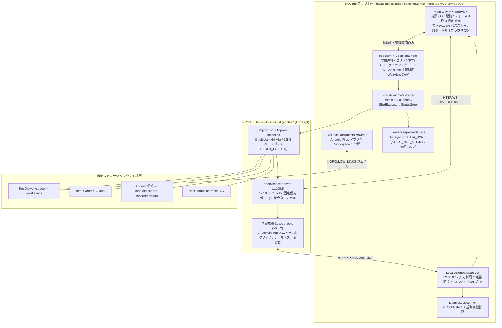

# KuCode

**空間に、書く。**
*Code in the space. — A self-contained code editor for spatial computing.*

> **APK 1 本で完結する、空間コンピューティング（Android XR / XREAL AURA 等）のためのコードエディタ。**

外部サーバーの構築・起動や Termux の別途導入は不要です。APK をインストールして起動するだけで、内蔵の **`openvscode-server` + Debian 12 minimal (`arm64`)** がローカルで自動起動し、物理キーボード＋マウス／トラックパッドですぐにコードを書き始められます。

---

## 名前の由来

**KuCode**（読み：**くうこーど** / 英: *"koo-code"*）は、**空（くう）** に二つの意味を重ねています。

- **空間** — Android XR の空間デスクトップに浮かび、目の前の空間にそのまま書けるコードエディタ。
- **空海** — 日本を代表する能書家。「弘法筆を選ばず」のとおり、場所や端末を選ばず自在に書ける道具でありたいという思い。

そこにコードエディタとしての系譜（`openvscode-server`）と、AI コーディング時代における開発体験を重ねて **KuCode** と名付けています（[ADR-0009](docs/adr/0009-brand-naming-kucode.md)）。

---

## コンセプト

### 3 本柱

1. **APK 1 本で完結**
   `PRoot`・`Debian 12 (bookworm-slim, arm64)`・`openvscode-server`・ライセンス一式を約 109 MiB の APK に同梱。初回起動時に自動展開・自動起動するため、サーバー構築も Termux の別途導入も不要です（[ADR-0001](docs/adr/0001-self-contained-apk-pivot.md), [ADR-0003](docs/adr/0003-debian-minimal-and-openvscode-server.md)）。
2. **空間デスクトップ最適化**
   物理キーボード＋マウス／トラックパッド前提で設計し、スマホ向け仮想キーや過剰な独自 UI は持ちません。実 `KeyEvent` パススルー、光学シースルー（OST）向け純黒 `#000000` 高コントラスト表示、非フォーカス自動減光、左 Activity Bar メニューに集中しています（[ADR-0006](docs/adr/0006-xr-spatial-desktop-ux-and-builtin-extension.md)）。
3. **Android 標準準拠でクリーン**
   `targetSdk = 35` を維持し、分離ローダー型 PRoot（16KB ページ対応）と Android 標準 SDK によるクリーンな Kotlin 実装（Termux GPL ソース非流用）で構成。ライセンス全文と Debian パッケージマニフェストも APK に自動同梱します（[ADR-0002](docs/adr/0002-proot-unbundled-loader-targetsdk35.md), [ADR-0008](docs/adr/0008-oss-license-compliance-and-manifest-bundling.md)）。

### 将来像

- **AI エージェントに強く** — 内蔵 Debian POSIX 環境上で CLI 系 AI エージェントがそのまま動き、人と AI が同じ `/workspace` で協働して書く体験を目指します。
- **空間コンピューティング最適化をさらに** — マルチウィンドウ／空間配置、視線・ハンドトラッキングなど、XR ならではの操作体験へと発展させていきます。

### つくった背景

XREAL AURA（Android XR）を使ってみると、動画視聴やハンドトラッキングの体験は素晴らしい一方で、プログラミング用途のエコシステムはまだ十分ではありませんでした（既存エディタで日本語入力ができない、Chrome 上のエディタは重い、UI がタブレット向けなど）。その穴を自分で埋めて、空間デスクトップ上で普通に開発できる道具を作るために KuCode を開発しました。

---

## クイックスタート

### 1. インストール

日常利用（`~/.ssh` や `gh` 認証トークン等を保存する用途）では、[GitHub Releases](https://github.com/koduki/3d-editor/releases) から署名済みリリース版 **`kucode-release.apk`** を取得するか、下記のローカル手順で署名済みリリース APK をビルドしてインストールしてください。

```bash
adb install -r kucode-release.apk
```

> **セキュリティ上の注意**：`kucode-debug.apk`（`debuggable = true`）は開発・動作確認専用です。debug ビルドでは `adb shell run-as` を通じてアプリ専用領域の `~/.ssh` や `~/.config/gh` トークン等を読み取れるため、実際の秘密鍵や認証情報を保存する用途には使用しないでください。

初回起動時は `boot.html` で内蔵ランタイムを自動展開し、`http://127.0.0.1:18765` が応答可能になると起動ごとのトークンで自動接続してエディタ UI へ切り替わります（2 回目以降は展開済み環境を再利用）。

### 2. 基本操作（物理キーボード & 左メニュー）

| 操作 | 方法 |
| --- | --- |
| ファイルを開く / クイックオープン | 左エクスプローラー、または `Ctrl+P` / `Ctrl+O` |
| 保存 / タブを閉じる | `Ctrl+S` / `Ctrl+W` |
| 統合ターミナルを開閉 | `Ctrl+J`、または左端 **KuCode** アイコン →「ターミナル開閉」 |
| 表示サイズ / OST・VST テーマ切替 | 左端 **KuCode** アイコン（`標準 / 大 / 特大`、`OST 純黒 / VST 暗灰`） |
| 実機チェック（レポート表示＆自動コピー） | 左端 **KuCode** アイコン →「実機チェックを実行」 |
| 管理画面（ログ・ミニ CLI・ライセンス・再起動） | `Ctrl+Alt+D`、または左端 **KuCode** アイコン →「管理画面を開く」 |

### 3. CLI ツール導入例（統合ターミナル内）

```bash
apt update && apt install -y ca-certificates git gh curl openssh-client
gh --version
```

`~/.ssh`・`~/.gitconfig`・`~/.config/gh` は `rootfs/` 外の永続領域（`/root`）に保存されるため、アプリ更新後も引き継がれます。

---

## システムアーキテクチャ



### ストレージ・マウント構造

| ホスト側（Android） | ゲスト側（Debian） | 用途・永続性 |
| --- | --- | --- |
| `filesDir/workspace` | `/workspace` | 作業用コード領域。`rootfs/` 外に分離され更新時も保持。`KuCodeDocumentsProvider` 経由で Android 標準「Files」アプリから直接読み書き可能。 |
| `filesDir/home` | `/root` | 永続ホーム（`~/.bashrc`, `~/.ssh`, `~/.gitconfig`, `~/.config/gh`, 履歴）。 |
| `filesDir/runtime/vscode-data` | `/var/lib/kucode-vscode` | `openvscode-server` の `settings.json`・拡張・状態領域（初期値は Machine 側のみにアトミック適用）。 |
| `filesDir/runtime/rootfs` | `/` | Debian 12 minimal + `/opt/openvscode-server`（更新時は `staging/` 経由でアトミック入替、失敗時は自動ロールバック）。 |
| `getExternalFilesDir("shared")` | `/android/shared` | 権限不要の Android 共有領域（`/workspace/android/shared` から参照）。 |
| `/storage/emulated/0` | `/android/sdcard` | 全ファイルアクセス許可時のみマウント（`/workspace/android/sdcard` から参照）。 |
| `filesDir/runtime/sysdata/*` | `/proc/{stat,loadavg,uptime,version,vmstat}` | Android の SELinux 制限で読めない `/proc` の補完用ダミーファイル。 |

---

## 主な機能

- **ランタイム起動 & 耐障害性**：`.tgz` アトミック展開（symlink/hardlink/chmod 保持＆パストラバーサル防御）、rootfs 内バージョン管理と READY コミット／失敗時ロールバック、優先固定ポート `18765`、Android システム DNS 動的同期、起動失敗時 `PROOT_NO_SECCOMP=1` 自動リトライ、Android 15 FGS 6 時間上限対策。
- **空間デスクトップ UX**：OST 純黒 `#000000` / VST 暗灰 `#12141a` 切替、表示サイズ 3 段階、フォーカス枠（`#38BDF8` / `#18181B`）＋非フォーカス自動減光（`alpha = 0.55f`）、ピンチズーム抑止、Back 誤終了ガード、別ポート `localhost`（例 `:3000`）および外部 URL の隣ウィンドウ起動、統合ターミナル `gpuAcceleration: "off"`。
- **内蔵拡張 & 実機診断**：左 Activity Bar の `KuCode` メニュー（`kucode-tools` を起動時自動同期）、並列実行する実機診断レポート生成＆自動クリップボードコピー、起動エラー時自動診断、非 PTY フォールバック CLI コンソール（`boot.html`）。
- **双方向ファイル共有 & コンプライアンス**：`KuCodeDocumentsProvider`（`NOFOLLOW_LINKS` 境界制御付き）、APK 内 `assets/licenses/` へのライセンス全文＋Debian パッケージマニフェスト自動同梱とアプリ内ライセンスビューア。

---

## 設計判断（Architecture Decision Records）

主要な技術選定・命名・設計理由・トレードオフは [`docs/adr/`](docs/adr/README.md) に決定事項ごとに記録しています。

| ADR | 決定内容の要点 |
| --- | --- |
| [ADR-0001](docs/adr/0001-self-contained-apk-pivot.md) | 単体完結 APK による最小構成アーキテクチャの採用 |
| [ADR-0002](docs/adr/0002-proot-unbundled-loader-targetsdk35.md) | `targetSdk = 35`（W^X）と 16KB ページ対応を維持するため、分離ローダー型 PRoot を `jniLibs` 同梱 |
| [ADR-0003](docs/adr/0003-debian-minimal-and-openvscode-server.md) | Debian 12 minimal (`glibc`/`apt`) + `openvscode-server` を採用し、AGP 対策で `.tgz` (`noCompress`) 同梱 |
| [ADR-0004](docs/adr/0004-decoupled-persistent-storage-and-documents-provider.md) | `/workspace`・`/root` を `rootfs/` 外へ永続分離し、`KuCodeDocumentsProvider` で双方向ファイル共有 |
| [ADR-0005](docs/adr/0005-fixed-port-and-isolated-security-boundaries.md) | 優先固定ポート `18765`・`KuCodeHost` 隔離・トークン認証ループバック管理 API（`X-KuCode-Token`） |
| [ADR-0006](docs/adr/0006-xr-spatial-desktop-ux-and-builtin-extension.md) | 実 `KeyEvent` パススルー・OST/フォーカス減光 UX・左 Activity Bar 内蔵拡張 `kucode-tools` |
| [ADR-0007](docs/adr/0007-on-device-diagnostics-and-non-pty-fallback.md) | 並列実行する実機診断チェッカー（自動クリップボードコピー）と非 PTY フォールバック CLI の内蔵 |
| [ADR-0008](docs/adr/0008-oss-license-compliance-and-manifest-bundling.md) | 本体 MIT 化、結合ライセンス表記・パッチ明示、ライセンス全文 & Debian マニフェストの APK 自動同梱 |
| [ADR-0009](docs/adr/0009-brand-naming-kucode.md) | プロダクト名称・由来・衝突調査・識別子体系を **KuCode** に統一 |

---

## コード構成 & ローカルビルド

### 主要ファイル

```text
.
├── README.md                               # 全体像・コンセプト・クイックスタート・ADR 索引（本ファイル）
├── spec.md                                 # 仕様書・実機検証ゲート
├── docs/adr/                               # 設計判断記録（ADR-0001〜0009）
├── LICENSE / THIRD_PARTY_NOTICES.md        # MIT ライセンス / 同梱 OSS 表記・対応ソース案内
├── LICENSES/                               # 同梱 OSS ライセンス全文（ビルド時に APK へ自動同期）
├── .github/workflows/ci.yml                # NDK PRoot + Debian + OpenVSCode 同梱 APK CI/CD
├── scripts/
│   ├── build-proot-android.sh              # Android NDK で PRoot + talloc (static) をビルド（SHA-256 検証付き）
│   └── fetch-runtime-assets.sh             # Debian rootfs (digest 固定) + openvscode-server + debian-manifest.txt
├── android/
│   ├── gradlew / gradle/wrapper/           # Gradle 8.11.1 Wrapper（SHA-256 検証付き）
│   └── app/src/
│       ├── main/
│       │   ├── assets/
│       │   │   ├── boot.html               # 起動進捗・ログ・実機診断・非PTY CLI・ライセンスビューア
│       │   │   ├── runtime-probes.cjs      # PTY / @parcel/watcher 実機検証スクリプト
│       │   │   └── kucode-tools/           # 内蔵拡張ソース（extension.js / package.json / icon.svg）
│       │   └── java/dev/koduki/kucode/     # Kotlin ホスト実装
│       │       ├── MainActivity.kt             # WebView・URL ルーティング・フォーカス減光・Clipboard
│       │       ├── PosixRuntimeConfig.kt       # 純 JVM 設定ビルダー（PRoot 引数・OST 設定・DNS・ルーティング）
│       │       ├── PosixRuntimeManager.kt      # ランタイムライフサイクル調停ファサード
│       │       ├── RuntimeStatusStore.kt       # アトミック状態スナップショット & リングバッファログ
│       │       ├── RuntimeInstaller.kt         # rootfs アトミック展開・ロールバック・Machine 設定マージ
│       │       ├── OpenVsCodeLauncher.kt       # openvscode-server 起動・seccomp 自動リトライ・疎通検証
│       │       ├── PosixShellExecutor.kt       # 非 PTY シェル実行・タイムアウト・キャンセル伝播
│       │       ├── RuntimeFiles.kt             # アトミック書込み・NOFOLLOW_LINKS 再帰削除ユーティリティ
│       │       ├── TarGzExtractor.kt           # POSIX symlink/hardlink/chmod 保持 .tgz 展開器
│       │       ├── WorkspaceDocumentStore.kt   # NOFOLLOW_LINKS 境界制御付き /workspace 操作層
│       │       ├── KuCodeDocumentsProvider.kt  # Android Files アプリ向け /workspace 公開プロバイダ
│       │       ├── VsCodeExtensionAsset.kt     # assets/kucode-tools/ のアトミック同期
│       │       ├── LocalDiagnosticsServer.kt   # 127.0.0.1 入力制限・定数時間トークン認証管理 HTTP サーバー
│       │       ├── DiagnosticsRunner.kt        # 並列実機診断コレクタ & Markdown レポート生成
│       │       ├── BootHostBridge.kt           # boot.html 専用非同期 JS ブリッジ & ライセンス読込
│       │       ├── HardwareShortcutRouter.kt   # ホスト側キーボード判定 (Ctrl+Alt+D)
│       │       └── ServerKeepAliveService.kt   # Foreground DATA_SYNC サービス (START_NOT_STICKY / onTimeout 対応)
│       └── test/java/dev/koduki/kucode/        # 小規模ユニットテスト & 中規模テスト（@Category(MediumTest) 分離）
└── tests/                                      # Node.js ユニットテスト（runtime-probes / kucode-tools 拡張）
```

### ローカルビルド手順

前提：JDK 17+、Android SDK（API 36 + Build-Tools 35.0.0 + NDK r27+）、Docker（`linux/arm64` イメージ出力用）、`python3`、`curl`、`make`、`node`

```bash
# 1. Android arm64-v8a 向け PRoot + talloc (static) をクロスコンパイル（SHA-256 検証付き）
./scripts/build-proot-android.sh

# 2. Debian 12 rootfs（digest ピン留め）+ openvscode-server（SHA-256 検証付き）+ debian-manifest.txt を準備
./scripts/fetch-runtime-assets.sh

# 3. Node.js テスト（内蔵拡張・プローブ）
node --check android/app/src/main/assets/kucode-tools/extension.js
node --test tests/runtime-probes.test.cjs tests/kucode-extension.test.cjs

# 4. 小規模ユニットテスト・中規模テスト実行
cd android
./gradlew :app:testDebugUnitTest :app:testDebugMediumUnitTest

# 5. 署名済み Release APK ビルド（日常利用推奨）
#    初回のみ keytool で鍵を作成してください：
#    keytool -genkeypair -v -keystore release.keystore -alias kucode -keyalg RSA -keysize 2048 -validity 10000
ANDROID_KEYSTORE_PATH=/path/to/release.keystore \
ANDROID_KEYSTORE_PASSWORD='...' \
ANDROID_KEY_ALIAS='kucode' \
ANDROID_KEY_PASSWORD='...' \
  ./gradlew :app:assembleRelease

# （開発・デバッグ検証用途のみ）Debug APK ビルド
./gradlew :app:assembleDebug
```

CI（[`.github/workflows/ci.yml`](.github/workflows/ci.yml)）ではビルドスクリプトのハッシュをキャッシュキーに含めて PRoot・ランタイム資産をキャッシュし、ビルドジョブは `contents: read` のみで実行します（`contents: write` は `v*` タグ時の `release` ジョブに限定）。

---

## ドキュメント構成 & ライセンス

| ドキュメント | 役割 |
| --- | --- |
| [README.md](README.md) | コンセプト・名前の由来・クイックスタート・全体アーキテクチャ・ADR 索引 |
| [spec.md](spec.md) | 機能スコープと実機検証ゲート |
| [docs/adr/](docs/adr/README.md) | 各設計判断の背景・代替案・トレードオフ（ADR-0001〜0009） |
| [LICENSE](LICENSE) | KuCode 本体（MIT License） |
| [THIRD_PARTY_NOTICES.md](THIRD_PARTY_NOTICES.md) | 同梱 OSS ライセンス表記・改変明示・対応ソース案内・商標免責 |
