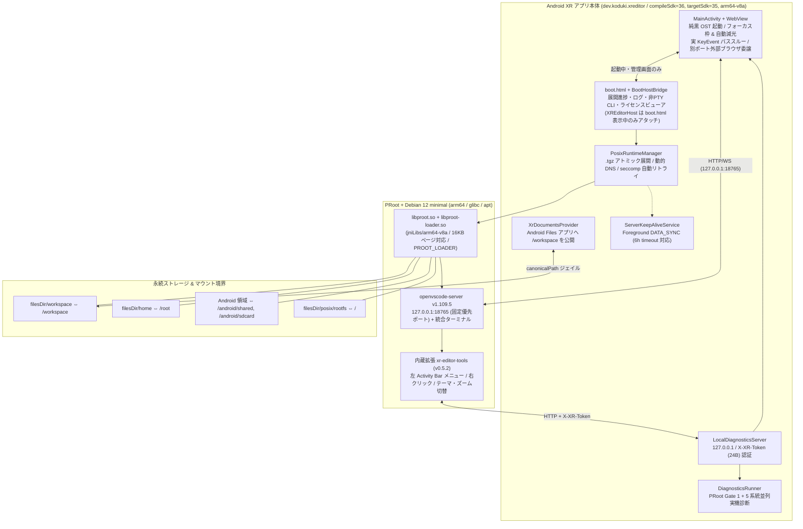

# XR-Editor

> **Android XR（XREAL AURA 等）の空間デスクトップ向けに、物理キーボード＋マウス／トラックパッドで使えるコードエディタと Debian POSIX 環境を APK 1 本に完全内蔵した開発者向けエディタ。**

外部サーバーの構築・起動や Termux の別途導入は不要です。APK をインストールして起動するだけで、内蔵の **`openvscode-server` + Debian 12 minimal (`arm64`)** がローカルで自動起動します。

---

## コンセプト

1. **APK 1 本で完全完結** — `PRoot`・`Debian 12 (bookworm-slim, arm64)`・`openvscode-server`・ライセンス一式を約 109 MiB の APK に同梱し、初回起動時に自動展開・自動起動します（[ADR-0001](docs/adr/0001-self-contained-apk-pivot.md), [ADR-0003](docs/adr/0003-debian-minimal-and-openvscode-server.md)）。
2. **空間デスクトップ最適化** — スマホ向け仮想キーや過剰な独自 UI を削ぎ落とし、物理キーボードの実 `KeyEvent` パススルー、純黒 OST（`#000000`）高コントラスト表示、非フォーカス自動減光、左 Activity Bar メニューに集中しています（[ADR-0006](docs/adr/0006-xr-spatial-desktop-ux-and-builtin-extension.md)）。
3. **Android 標準仕様（`targetSdk = 35`）準拠** — `targetSdk = 28` へのダウングレードや Termux GPL ソースの流用を行わず、分離ローダー型 PRoot（16KB ページ対応）と Android 標準 SDK によるクリーンな Kotlin 実装で構成しています（[ADR-0002](docs/adr/0002-proot-unbundled-loader-targetsdk35.md), [ADR-0008](docs/adr/0008-oss-license-compliance-and-manifest-bundling.md)）。

---

## クイックスタート

### 1. インストール
[GitHub Releases](https://github.com/koduki/3d-editor/releases)（推奨：`v0.5.0` 以降）または GitHub Actions Artifacts（`xr-editor-debug-apk`）から `xr-editor-debug.apk` を取得します。

```bash
adb install -r xr-editor-debug.apk
```

初回起動時は `boot.html` で内蔵ランタイムを自動展開し、`http://127.0.0.1:18765` が応答可能になると自動で VS Code UI へ切り替わります（2 回目以降は展開済み環境を再利用）。

### 2. 基本操作（物理キーボード & 左メニュー）

| 操作 | 方法 |
| --- | --- |
| ファイルを開く / クイックオープン | 左エクスプローラー、または `Ctrl+P` / `Ctrl+O` |
| 保存 / タブを閉じる | `Ctrl+S` / `Ctrl+W` |
| 統合ターミナルを開閉 | `Ctrl+J`、または左端 **XR-Editor** アイコン →「統合ターミナルを開閉」 |
| 表示サイズ / OST・VST テーマ切替 | 左端 **XR-Editor** アイコン（`標準 / 大 / 特大`、`OST 純黒 / VST 暗灰`） |
| 実機チェック（レポート表示＆自動コピー） | 左端 **XR-Editor** アイコン →「実機チェックを実行」 |
| 管理画面（ログ・ミニ CLI・ライセンス・再起動） | `Ctrl+Alt+D`、または左端 **XR-Editor** アイコン →「管理画面を開く」 |

### 3. CLI ツール導入例（統合ターミナル内）

```bash
apt update && apt install -y ca-certificates git gh curl openssh-client
gh --version
```

`~/.ssh`・`~/.gitconfig`・`~/.config/gh` は `rootfs/` 外の永続領域（`/root`）に保存されるため、アプリ更新後も引き継がれます。

---

## システムアーキテクチャ



### ストレージ・マウント構造

| ホスト側（Android） | ゲスト側（Debian） | 用途・永続性 |
| --- | --- | --- |
| `filesDir/workspace` | `/workspace` | 作業用コード領域。`rootfs/` 外に分離され更新時も保持。`XrDocumentsProvider` 経由で Android 標準「Files」アプリから直接読み書き可能。 |
| `filesDir/home` | `/root` | 永続ホーム（`~/.bashrc`, `~/.ssh`, `~/.gitconfig`, `~/.config/gh`, 履歴）。旧 `rootfs/` 内データがある場合は自動移行。 |
| `filesDir/posix/vscode-data` | `/var/lib/xr-vscode` | `openvscode-server` の `settings.json`・拡張・状態領域。 |
| `filesDir/posix/rootfs` | `/` | Debian 12 minimal + `/opt/openvscode-server`（更新時は `staging/` 経由でアトミック入替）。 |
| `getExternalFilesDir("shared")` | `/android/shared` | 権限不要の Android 共有領域（`/workspace/android/shared` から参照）。 |
| `/storage/emulated/0` | `/android/sdcard` | 全ファイルアクセス許可時のみマウント（`/workspace/android/sdcard` から参照）。 |
| `filesDir/posix/sysdata/*` | `/proc/{stat,loadavg,uptime,version,vmstat}` | Android の SELinux 制限で読めない `/proc` の補完用ダミーファイル。 |

---

## 現時点の実装機能（v0.5.0）

- **ランタイム起動 & 耐障害性**：`.tgz` アトミック展開（symlink/hardlink/chmod 保持＆パストラバーサル防御）、優先固定ポート `18765`、Android システム DNS 動的同期、起動失敗時 `PROOT_NO_SECCOMP=1` 自動リトライ、Android 15 FGS 6 時間上限対策。
- **Android XR 空間デスクトップ UX**：OST 純黒 `#000000` / VST 暗灰 `#12141a` 切替、表示サイズ 3 段階、フォーカス枠（`#38BDF8` / `#18181B`）＋非フォーカス自動減光（`alpha = 0.55f`）、ピンチズーム抑止、Back 誤終了ガード、別ポート `localhost`（例 `:3000`）および外部 URL の隣 XR ブラウザ起動、統合ターミナル `gpuAcceleration: "off"`。
- **内蔵拡張 & 実機診断**：左 Activity Bar の `XR-Editor` メニュー（システム拡張として起動時自動同期）、5 系統並列の実機診断レポート生成＆自動クリップボードコピー、起動エラー時自動診断、非 PTY フォールバック CLI コンソール（`boot.html`）。
- **双方向ファイル共有 & コンプライアンス**：`XrDocumentsProvider`（`canonicalPath` ジェイル付き）、APK 内 `assets/licenses/` へのライセンス全文＋Debian パッケージマニフェスト自動同梱とアプリ内ライセンスビューア。

---

## 設計判断（Architecture Decision Records）

主要な技術選定・設計理由・検討した代替案・トレードオフは [`docs/adr/`](docs/adr/README.md) に決定事項ごとに記録しています。

| ADR | 決定内容の要点 |
| --- | --- |
| [ADR-0001](docs/adr/0001-self-contained-apk-pivot.md) | v0.4.0 の外部サーバー＋独自 Web IDE を廃止し、単体完結 APK（Minimal Reboot）へピボット |
| [ADR-0002](docs/adr/0002-proot-unbundled-loader-targetsdk35.md) | `targetSdk = 35`（W^X）と 16KB ページ対応を維持するため、分離ローダー型 PRoot を `jniLibs` 同梱 |
| [ADR-0003](docs/adr/0003-debian-minimal-and-openvscode-server.md) | Debian 12 minimal (`glibc`/`apt`) + `openvscode-server` を採用し、AGP 対策で `.tgz` (`noCompress`) 同梱 |
| [ADR-0004](docs/adr/0004-decoupled-persistent-storage-and-documents-provider.md) | `/workspace`・`/root` を `rootfs/` 外へ永続分離し、`XrDocumentsProvider` で双方向ファイル共有 |
| [ADR-0005](docs/adr/0005-fixed-port-and-isolated-security-boundaries.md) | 優先固定ポート `18765`・`XREditorHost` 隔離・トークン認証ループバック管理 API（`X-XR-Token`） |
| [ADR-0006](docs/adr/0006-xr-spatial-desktop-ux-and-builtin-extension.md) | 実 `KeyEvent` パススルー・OST/フォーカス減光 UX・左 Activity Bar 内蔵拡張 `xr-editor-tools` |
| [ADR-0007](docs/adr/0007-on-device-diagnostics-and-non-pty-fallback.md) | 5 系統並列の実機診断チェッカー（自動クリップボードコピー）と非 PTY フォールバック CLI の内蔵 |
| [ADR-0008](docs/adr/0008-oss-license-compliance-and-manifest-bundling.md) | 本体 MIT 化、結合ライセンス表記・パッチ明示、ライセンス全文 & Debian マニフェストの APK 自動同梱 |

---

## コード構成 & ローカルビルド

### 主要ファイル

```text
.
├── README.md                               # 全体像・クイックスタート・ADR 索引（本ファイル）
├── spec.md                                 # v0.5.0 仕様書・実機検証ゲート
├── docs/adr/                               # 設計判断記録（ADR-0001〜0008）
├── LICENSE / THIRD_PARTY_NOTICES.md        # MIT ライセンス / 同梱 OSS 表記・対応ソース案内
├── LICENSES/                               # 同梱 OSS ライセンス全文（ビルド時に APK へ自動同期）
├── .github/workflows/ci.yml                # NDK PRoot + Debian + OpenVSCode 同梱 APK CI/CD
├── scripts/
│   ├── build-proot-android.sh              # Android NDK で PRoot + talloc (static) をビルド
│   └── fetch-runtime-assets.sh             # Debian rootfs + openvscode-server + debian-manifest.txt を生成
└── android/app/src/
    ├── main/
    │   ├── assets/boot.html                # 起動進捗・ログ・実機診断・非PTY CLI・ライセンスビューア
    │   └── java/dev/koduki/xreditor/       # Kotlin ホスト実装（11 ファイル）
    │       ├── MainActivity.kt             # WebView・URL ルーティング・フォーカス減光・Clipboard
    │       ├── PosixRuntimeConfig.kt       # 純 JVM 設定ビルダー（PRoot 引数・OST 設定・DNS・ルーティング）
    │       ├── PosixRuntimeManager.kt      # アトミック展開・PRoot 制御・自動復旧・拡張同期
    │       ├── TarGzExtractor.kt           # POSIX symlink/hardlink/chmod 保持 .tgz 展開器
    │       ├── XrDocumentsProvider.kt      # Android Files アプリ向け /workspace 公開プロバイダ
    │       ├── VsCodeExtensionAsset.kt     # 内蔵拡張 xr-editor-tools (v0.5.2) 生成
    │       ├── LocalDiagnosticsServer.kt   # 127.0.0.1 トークン認証管理 HTTP サーバー
    │       ├── DiagnosticsRunner.kt        # 並列実機診断コレクタ & Markdown レポート生成
    │       ├── BootHostBridge.kt           # boot.html 専用非同期 JS ブリッジ & ライセンス読込
    │       ├── HardwareShortcutRouter.kt   # ホスト側キーボード判定 (Ctrl+Alt+D)
    │       └── ServerKeepAliveService.kt   # Foreground DATA_SYNC サービス (onTimeout 対応)
    └── test/java/dev/koduki/xreditor/      # ユニットテスト 5 本
```

### ローカルビルド手順

前提：JDK 17、Android SDK（API 36 + Build-Tools 35.0.0 + NDK r27+）、Docker（`linux/arm64` イメージ出力用）、`python3`、`curl`、`make`

```bash
# 1. Android arm64-v8a 向け PRoot + talloc (static) をクロスコンパイル
./scripts/build-proot-android.sh

# 2. Debian 12 rootfs + openvscode-server + debian-manifest.txt を準備
./scripts/fetch-runtime-assets.sh

# 3. ユニットテスト実行 & Debug APK ビルド（ライセンス一式も assets/licenses/ へ自動同梱）
cd android
gradle :app:testDebugUnitTest :app:assembleDebug
```

CI（[`.github/workflows/ci.yml`](.github/workflows/ci.yml)）では PRoot・ランタイム資産をキャッシュし、約 1 分半でユニットテスト・APK 内アセット／ライセンス検証・Artifact 公開（`v*` タグ時は GitHub Release 自動公開）まで実行します。

---

## ドキュメント構成 & ライセンス

| ドキュメント | 役割 |
| --- | --- |
| [README.md](README.md) | プロジェクト概要・クイックスタート・全体アーキテクチャ・入口 |
| [spec.md](spec.md) | v0.5.0 の機能スコープと実機検証ゲート |
| [docs/adr/](docs/adr/README.md) | 各設計判断の背景・代替案・トレードオフ（ADR-0001〜0008） |
| [LICENSE](LICENSE) | XR-Editor 本体（MIT License） |
| [THIRD_PARTY_NOTICES.md](THIRD_PARTY_NOTICES.md) | 同梱 OSS ライセンス表記・改変明示・対応ソース案内・商標免責 |
